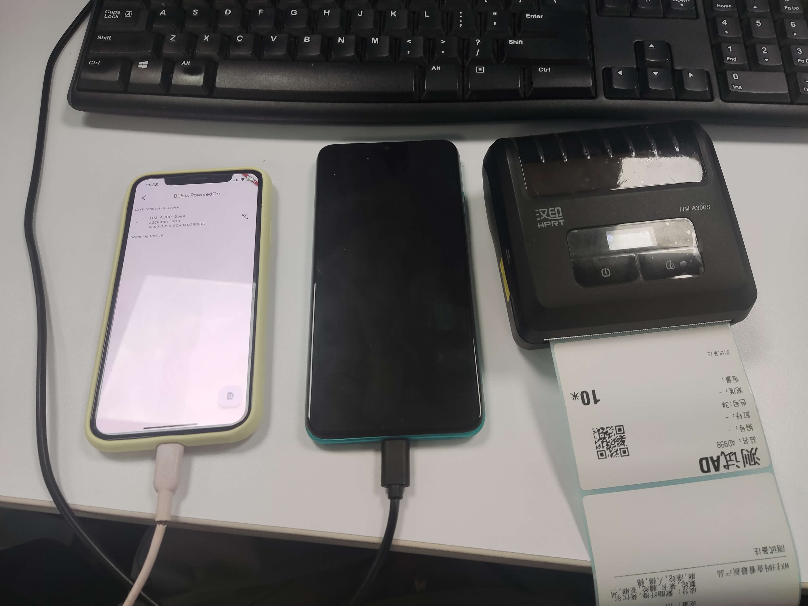

# hm_a300_ble_printer

[](https://pub.dartlang.org/packages/hm_a300_ble_printer) [](https://github.com/jawa0919/hm_a300_ble_printer/issues)

a flutter plugin for HM-A300 ble printer.

[HM-A300-sdk-site](https://www.hprt.com.cn/search_keywork.html?search_key=HM-A300&search_num=21)

## Function

- [x] Android
- [x] iOS



## Other

### pigeon

```shell
dart run pigeon --input pigeon/messages.dart
```

### publish

```shell
flutter pub publish --dry-run -v
flutter pub publish --server=https://pub.dev -v
```
